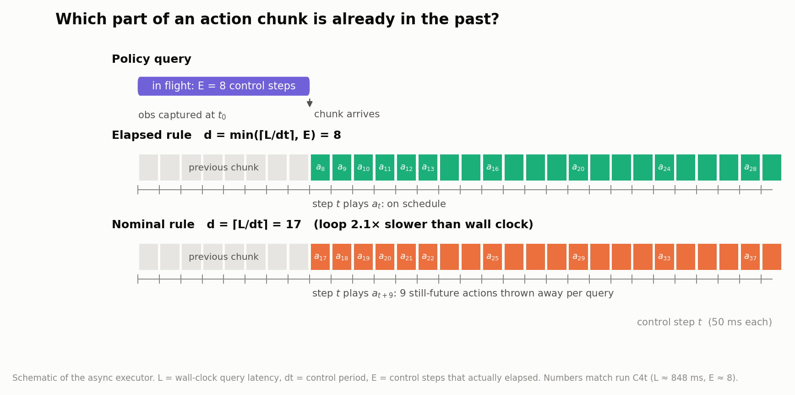
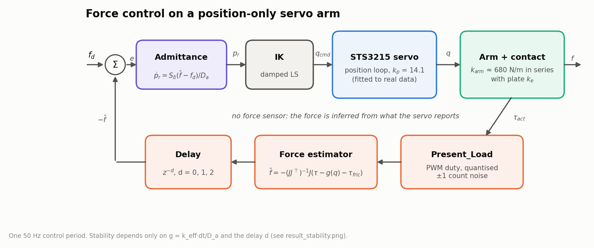
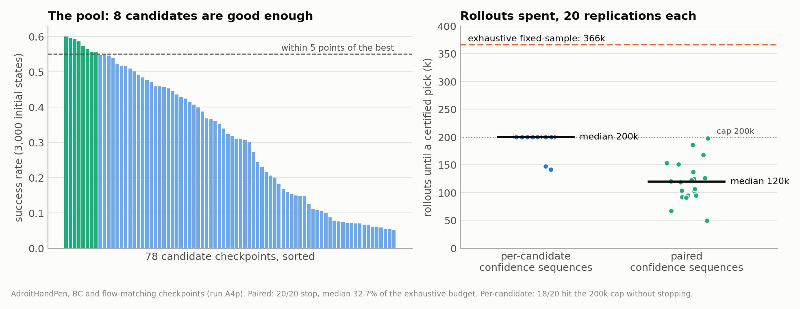
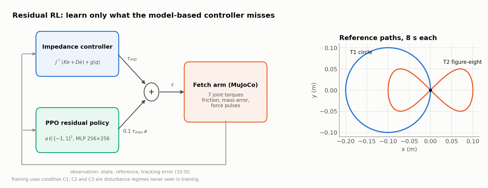
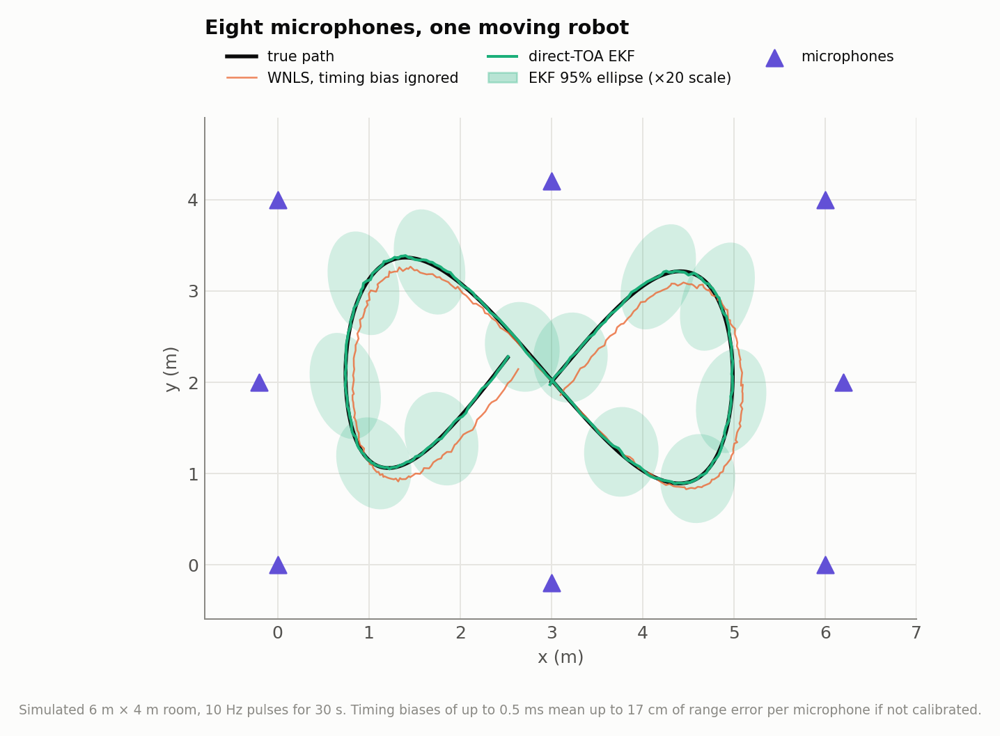
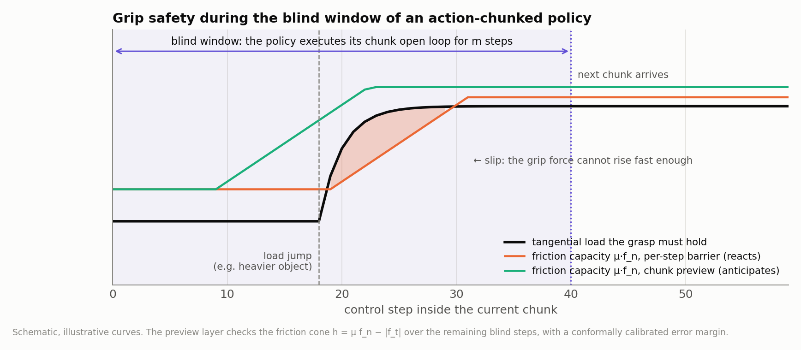

# Robotics & Control Portfolio

[](https://github.com/chorched/robotics-control-portfolio/actions/workflows/tests.yml)

**Allen Li** · MSc Systems and Control, TU Delft · [LinkedIn](https://www.linkedin.com/in/allen-li-767913163)

Personal projects in robot control, estimation and robot learning. Each one starts from a concrete
engineering problem, builds the tool or controller, and measures it with pre-stated decision rules.
Negative results are reported, not dropped. All work here is my own and contains no code or data from
any employer.

## Projects

<table>
<tr>
<td width="50%" valign="top">
<a href="projects/vla-realtime/"></a><br>
<a href="projects/vla-realtime/"><b>Real-time execution of a VLA policy</b></a><br>
SmolVLA on LIBERO with a slow GPU policy and a 50 Hz loop: chunk executors, the stale-action bug, what governs real-time success.<br><br>
Success <b>0/24 → 15/24</b> after fixing the stale-action rule · 3 vs 10 denoising steps: <b>51/56 vs 17/56</b>
</td>
<td width="50%" valign="top">
<a href="projects/servo-compliance/"></a><br>
<a href="projects/servo-compliance/"><b>Compliant control of a low-cost servo arm</b></a><br>
Force control on an SO-101 that only accepts position commands: servo audit, model identification, admittance stability, learned load detection.<br><br>
Servo model NRMSE <b>0.164 → 0.085</b> · stability limit with delay derived, then confirmed in closed-loop MuJoCo
</td>
</tr>
<tr>
<td width="50%" valign="top">
<a href="projects/policy-evaluation/"></a><br>
<a href="projects/policy-evaluation/"><b>Sample-efficient evaluation of robot policies</b></a><br>
Picking the best of 78 checkpoints with anytime-valid paired confidence sequences; numpy-only tool with a CLI.<br><br>
<b>32.7%</b> of the rollouts of exhaustive evaluation · offline loss picks BC checkpoints <b>26 points</b> worse
</td>
<td width="50%" valign="top">
<a href="projects/residual-rl/"></a><br>
<a href="projects/residual-rl/"><b>Residual RL for torque-level tracking</b></a><br>
Residual PPO on an impedance controller for a torque-actuated Fetch arm under friction, mass and force disturbances.<br><br>
Beats the tuned impedance controller in <b>7 of 8</b> pre-registered cells · plain PPO terminates in 60–80% of episodes
</td>
</tr>
<tr>
<td width="50%" valign="top">
<a href="projects/toa-ekf-localization/"></a><br>
<a href="projects/toa-ekf-localization/"><b>Acoustic TOA calibration and EKF localization</b></a><br>
Sensor-bias calibration, weighted NLS, Kalman and extended Kalman filtering with NIS/NEES consistency checks.<br><br>
Calibration cuts RMSE <b>165 → 17 mm</b> · EKF <b>13 mm</b>, consistent at the 95% level
</td>
<td width="50%" valign="top">
<a href="projects/slip-safety-paper/"></a><br>
<a href="projects/slip-safety-paper/"><b>Latency-aware slip safety for chunked policies <i>(paper in progress)</i></b></a><br>
A friction-cone safety layer that previews the blind steps of an action-chunked policy.<br><br>
Near the friction limit, drops <b>197 → 23</b> · latency-aware preview faster than a fixed worst-case margin
</td>
</tr>
</table>

## How the work is done

- **Problem first.** Each project states what fails and why, before the method.
- **Pre-registered decisions.** Hypotheses, thresholds and analysis code were fixed (and hashed)
  before the main runs, and comparison sentences come from a stated rule.
- **Reproducible.** Every figure is regenerated from data in the repository by `figures/make_figures.py`.
  Shipped result tables let the statistics be re-derived bit for bit, and the tests check that they are.
- **Honest limits.** Each README ends with what the results do *not* show.

## Skills shown

Control: admittance and impedance control, discrete-time stability with delay, control barrier
functions, actuator identification · Estimation: Kalman / extended Kalman filters, nonlinear least
squares, sensor calibration, consistency testing · Robot learning: VLA deployment, action chunking,
flow matching, behaviour cloning, PPO / residual RL · Statistics: anytime-valid confidence sequences,
bootstrap, paired designs · Tools: Python, NumPy, PyTorch, MuJoCo, LeRobot, Stable-Baselines3,
Docker, MATLAB.

```bash
git clone https://github.com/chorched/robotics-control-portfolio
cd robotics-control-portfolio/projects/<project>
pip install -r requirements.txt && python -m pytest tests -q
```
