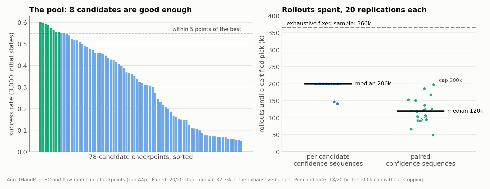
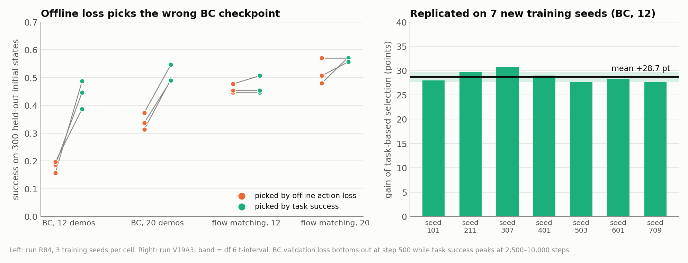
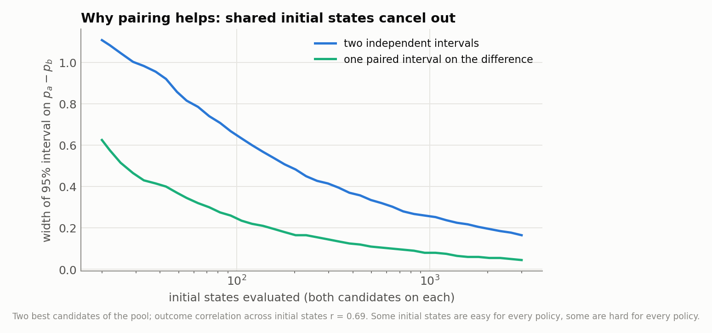
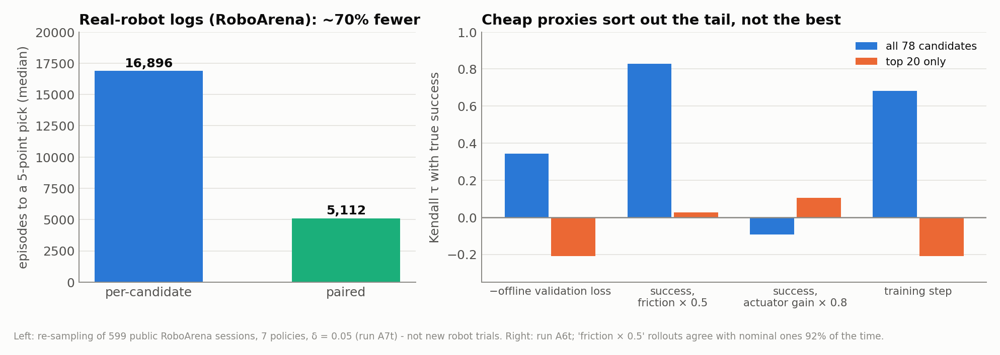

# Sample-efficient evaluation of robot learning policies

**Checkpoint selection · anytime-valid confidence sequences · paired evaluation · AdroitHandPen · RoboArena**



Training a robot policy is cheap compared with evaluating it: every checkpoint has to be rolled out,
and every rollout costs simulator time or, on a real robot, an operator's time. In practice the shortcut
is to pick the checkpoint with the lowest validation loss. This project asks two questions:

1. **Does the cheap signal pick the right checkpoint?** For behaviour cloning on a dexterous-hand task, no.
2. **How few rollouts are enough to pick one that is provably near-best?** Far fewer than evaluating
   everything, as long as all candidates are rolled out **on the same initial states** and compared in pairs.

## Results

| Finding | Evidence |
| --- | --- |
| Picking BC checkpoints by task success instead of offline action loss: **44% vs 18%** success (+26 points). Replicated on 7 new training seeds: **+28.7 points** (df-6 t-interval 27.7–29.8); over all 10 seeds +27.9. | Runs R84, V19A3 |
| Paired sequential selection over 78 candidates stops after a median **32.7%** of the rollouts of exhaustive evaluation (119,678 vs 366,288). It stopped in 20/20 replications, against 2/20 for per-candidate confidence sequences under a 200k cap. | Run A4p |
| On fresh initial states the median is 35.3% of exhaustive; 10/10 picks are certified within 5 points of the best. | Run A10t |
| Re-sampling 599 public real-robot sessions (RoboArena, 7 policies): pairing needs **~70% fewer** episodes (5,112 vs 16,896). | Run A7t |
| Negative result: cheap proxies (offline loss, perturbed physics, training step) rank the whole pool reasonably (Kendall τ up to 0.83). Within the top 20 they are near zero or negative (−0.21 … 0.11), so they can prune the tail but cannot find the best. | Run A6t |

## 1 · The cheap signal picks the wrong checkpoint

Behaviour-cloning (BC) and flow-matching action-chunking policies were trained on AdroitHandPen-v1
from the D4RL `pen-human-v1` demonstrations: 3 training seeds × {1, 3, 12, 20} demonstrations, with
checkpoints at 0 … 10k steps. The BC validation loss reaches its minimum at step 500, while task success
keeps rising until 2,500–10,000 steps.



## 2 · Why pairing on initial states helps

Success depends heavily on the initial state: some pen orientations are easy for every policy, some
are hard for every policy. For the two best candidates the outcomes are correlated at r = 0.69 across
initial states. An interval on the **difference** of paired outcomes cancels that shared difficulty;
two separate intervals cannot.



## 3 · The method

Each candidate pair $(j, k)$ carries an anytime-valid confidence sequence on $p_j - p_k$, built from the
paired differences $Y_j(s) - Y_k(s)$ on shared initial states $s$. It uses the hedged-betting construction
of Waudby-Smith & Ramdas (existing method): a capital process

$$
K_t(m) = \tfrac12 \prod_{i\le t}\big(1 + \lambda_i^{+}(x_i - m)\big) + \tfrac12 \prod_{i\le t}\big(1 - \lambda_i^{-}(x_i - m)\big),
\qquad \mathrm{CS}_t = \{ m : K_t(m) < 1/\alpha \}.
$$

Because the sequence is valid at every sample size simultaneously, I can look after every round of
rollouts and stop as soon as one candidate is shown to be within $\delta$ of all others. Error control is
split over the $K(K-1)/2$ pairs. The same machinery then **certifies** a finished selection on an
independent reference set (277k rollouts). It turns the bound on the regret $\max_j p_j - p_\text{sel}$ into a
verdict of *correct*, *wrong* or *undecidable*. The paired regret bounds were 0.0225–0.0275, against
0.065–0.070 from per-candidate intervals.



## Code

```
paired_cs/          the tool: numpy-only package with a CLI (see paired_cs/README.md)
  cs.py             batched hedged-betting confidence sequence (log-capital, grid of 400)
  select.py         sequential selection, paired (S2_pair) and per-candidate (S2_marg)
  certify.py        regret bounds and three-valued verdict, missing-rival handling
  cli.py            python -m paired_cs select | certify
pen/policies.py     the BC / flow-matching chunk policies and their rollout (PyTorch, gymnasium-robotics)
data/               selection_pool.npz (78 × 3,000 outcomes), reference.npz (78 × up to 10,000), expected.json
results/            numbers behind the figures, each tagged with its run id
figures/            make_figures.py regenerates all plots
tests/              coverage, bit-exact regressions, CLI, missing-rival edge case
```

```bash
pip install numpy matplotlib pytest
python -m pytest tests -q                       # 12 tests, ~80 s; RUN_SLOW=1 adds the 20-replication check
python -m paired_cs select  --table data/selection_pool.npz --method pair --delta 0.05 --seed 0
python -m paired_cs certify --reference data/reference.npz --selected fm_mask_N20_s43/step5000 --n-comparisons 231
python figures/make_figures.py
```

The rollout outcomes ship with the repository (≈100 kB), so the selection runs and the certification
can be reproduced **bit for bit** without a simulator. The test suite does this: it replays the recorded
selection and recomputes the recorded regret bounds to within 1e-9.

## Limits

- The main study is one simulated task (AdroitHandPen). The RoboArena part re-samples published
  real-robot logs; it is not a new robot experiment.
- The paired certification method was adopted after seeing the per-candidate intervals' results, so it is
  a post-hoc change of analysis. The original per-candidate verdicts are kept in the run records.
- In-pool and fresh-state certification share one reference set. On fresh states the correct-pick rate has
  a Clopper–Pearson 95% interval of [0.69, 1.00] from 10 replications; the protocol called for 20.
- The three selected candidates cannot be told apart on the reference set, so "correct" means "within
  5 points of the best", not "the single best".
- Method comparisons at small data (≤ 3 demonstrations) did not predict the ranking at 20
  demonstrations, and 3 training seeds under-estimate seed-to-seed spread by 1.4–2.4×. Both are reasons
  the replication above uses 7 new seeds.
- `pen/policies.py` is the model, loss and rollout extracted from my training script. The checkpoint pool
  itself was produced with the original script, and the extracted module has not been retrained here.
