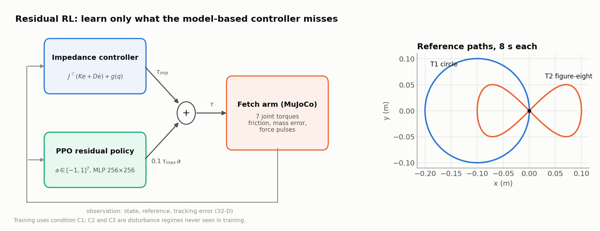
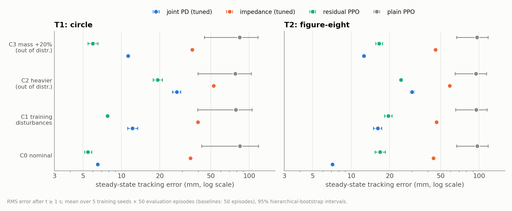
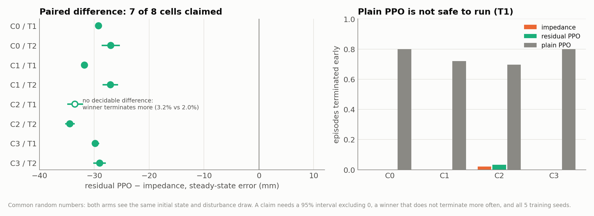

# Residual RL for torque-level tracking

**Fetch 7-DoF arm · joint torques · residual PPO on an impedance controller · pre-registered claim rule**



A model-based controller only knows the nominal model. A reinforcement-learning policy learns from
scratch and is unsafe while it does. Residual RL combines the two: keep a classical controller in charge
and let PPO add a small learned torque on top,

$$
\tau = \underbrace{J^\top\big(K e + D \dot e\big) + g(q)}_{\text{impedance, nominal model}} + \alpha\,\tau_{\max}\,a,
\qquad a = \pi_\theta(o) \in [-1,1]^7,\ \alpha = 0.1 .
$$

I built a torque-level version of the Fetch arm in MuJoCo by releasing the mocap weld and injecting seven
torque actuators. The arm has to track a circle and a figure-eight while the simulated plant has extra
joint friction, link mass errors and random force pulses that the controller's model does not know about.
I then compared residual PPO, plain PPO and two tuned classical baselines.

## Results

| Finding | Evidence |
| --- | --- |
| Residual PPO has lower steady-state error than the tuned impedance controller it sits on, in **7 of 8** condition × trajectory cells, including both out-of-distribution regimes (C2, C3). Typical gain: −27 to −35 mm. | Pre-registered paired claim rule, 5 training seeds × 50 episodes |
| The 8th cell (C2/T1) is reported as **no decidable difference**. The interval excludes zero, but residual PPO terminated slightly more often there (3.2% vs 2.0%), and the rule does not allow a claim in that case. | Claim rule |
| Plain PPO with the same budget (1M steps) **terminates early in 60–80% of episodes** in every condition. | |
| Honest boundary: a tuned joint-space PD is still better on the figure-eight (C0/T2: 7.1 mm vs 16.9 mm). The baselines got 43 tuning configurations against 3 for RL, and both baseline optima lie on the edge of the searched grid. | |





## Setup

| | |
| --- | --- |
| Plant | gymnasium-robotics Fetch model, mocap weld released, 7 torque actuators with limits `TAU_MAX`, 2 ms physics, 50 Hz control |
| Task | follow a 0.1 m circle (T1) or figure-eight (T2) with the gripper for 8 s; terminate if the error exceeds 0.15 m, a joint exceeds 10 rad/s, or MuJoCo warns |
| Disturbances (plant only) | C1 (training): viscous + Coulomb friction, mass ×0.8–1.3, 0.2 s force pulses. C2: 1.5× friction and pulses, mass ×1.3–1.5. C3: mass ×1.2 |
| Baselines | joint PD on IK targets (kp 800, kd 30) and Cartesian impedance (K 800, D 80), both with gravity compensation, grid-searched |
| RL | SB3 PPO, MLP 256×256 tanh, 8 parallel CPU environments (~3,600 steps/s), observation and reward normalisation, linear LR decay. 5 seeds × {residual, plain} × ~1M steps |
| Metric | RMS tracking error after t ≥ 1 s (e_rms_ss); also full-episode RMS, peak error, termination rate |

## How claims are made

Every comparison sentence in this README comes from `residual_rl/claims.py`; none is written by hand.

1. Episodes are paired by common random numbers: both arms face the same initial state and the same
   sampled disturbance.
2. The mean paired difference gets a hierarchical-bootstrap 95% interval: resample training seeds, then
   episodes within each seed, 10,000 times.
3. "A better than B" requires that the interval excludes 0, that the winner terminates no more often,
   and that every planned training seed was evaluated. Otherwise the sentence reads "no decidable
   difference".

In the original runs the configuration, the code files and the claim rule were frozen and
SHA-256-locked before the main runs, and the run ledger was append-only. 160 comparisons were made;
102 produced a claim.

## Code

```
residual_rl/
  env.py          FetchTorqueEnv: torque-actuated Fetch, reference paths, disturbance conditions C0–C3
  controllers.py  JointPD, Impedance
  residual.py     ResidualEnv wrapper, reward, frozen configuration, PPO training, episode evaluation
  claims.py       hierarchical bootstrap + claim rule -> results/claims.json
results/
  eval.csv.gz     all 8,800 evaluation episodes (6 arms × 4 conditions × 2 paths × seeds × 50)
  claims.json     every group mean and every comparison with its sentence
figures/          make_figures.py regenerates all plots from claims.json
tests/            claim counts, the 7/8 verdict, the decision rule, baseline errors reproduced from the env
```

```bash
pip install numpy matplotlib pytest                    # claims, figures, tests
pip install mujoco gymnasium-robotics stable-baselines3 torch
python -m residual_rl.claims                           # re-derives every claim from eval.csv.gz
python -m pytest tests -q
python -m residual_rl.residual --method residual --seed 0 --steps 1000000 --out runs/residual_s0
```

**Reproducibility check.** `claims.py` regenerates all 160 comparisons and the same 102 claims from the
shipped episode table. Run through the cleaned-up environment, the impedance and joint-PD baselines
reproduce the recorded nominal errors to six digits (34.718 mm and 6.5135 mm).
*Windows note:* if two OpenMP runtimes are installed (PyTorch + MuJoCo), set
`KMP_DUPLICATE_LIB_OK=TRUE`; the original runs did the same.

## Limits

- Simulation only, one arm, two reference paths.
- The tuning budgets are asymmetric (43 baseline configurations vs 3 RL pilots), and both baseline
  optima lie on the edge of the grid even after one expansion. A wider search could make the baselines
  stronger.
- Residual PPO beats the controller it is built on. It is better than joint PD on the circle in every
  condition, but that comparison was not part of the pre-registered set, so it is descriptive only.
  On the figure-eight, joint PD stays better.
- The trained models are not included (size); `residual.py` re-trains them with the frozen configuration.
