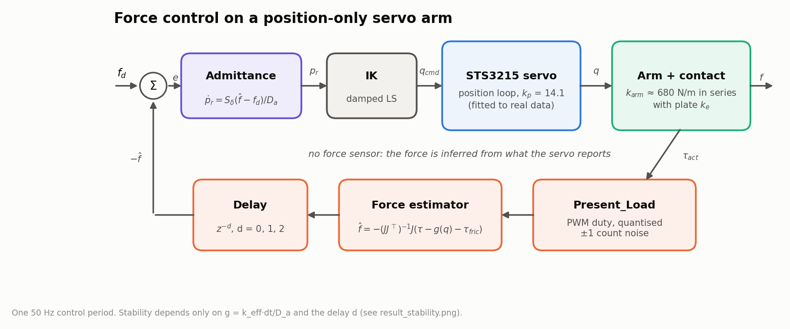
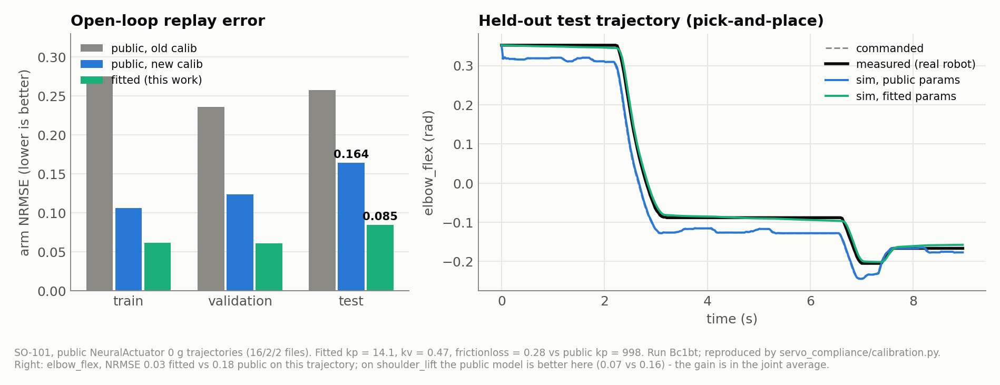
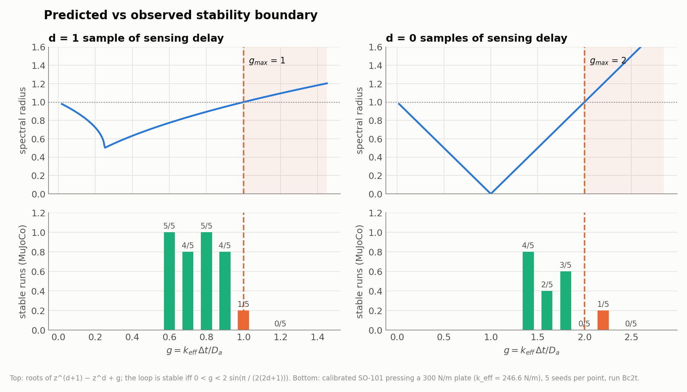
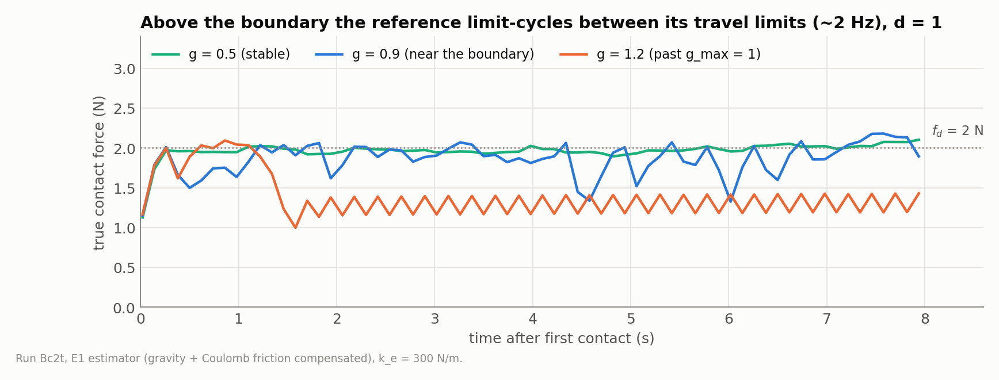
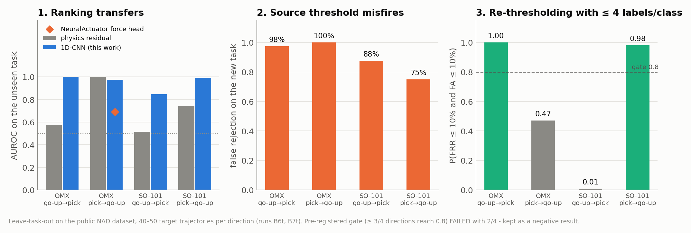

# Compliant control of a low-cost servo arm

**SO-101 · STS3215 hobby servos · actuator identification · admittance control · MuJoCo**



The SO-101 is a ~€200 arm built from Feetech STS3215 servos. The servos accept position commands
only and have no torque sensor. Can such an arm still feel contact and press with a controlled force?

I worked through the chain bottom-up: what the servo registers actually mean, a servo model fitted to
real-robot data, a force estimator built on that model, and an admittance controller with a stability
condition derived on paper and then checked in simulation. A learned payload detector is tested
separately, on tasks it was not trained on.

## Results

| Step | Result |
| --- | --- |
| **Signal audit** | `Present_Load` is a PWM duty cycle, not a torque; `Present_Current` is sign-magnitude and LeRobot reads it as unsigned. On real data the duty cycle is the better torque proxy (R² 0.56–0.83 per joint vs 0.01–0.71). |
| **Servo model** | Fitted to public real-robot trajectories: test NRMSE **0.164 → 0.085** against the public MuJoCo model. The effective gain is $k_p = 14.1$; the public model uses 998. |
| **Stability condition** | Pure-damping admittance with $d$ samples of sensing delay is stable iff $0 < g < 2\sin\frac{\pi}{2(2d+1)}$, i.e. $g<2$ for $d=0$ and $g<1$ for $d=1$. In closed-loop MuJoCo, sustained instability starts **exactly at $g=1$ and $g=2$**. |
| **Force accuracy** | Bound $\lvert f_{ss}-f_d\rvert \le \delta + \lvert e_{ss}\rvert$ held on **16/16** evaluable runs; best steady-state error 0.022 N at $f_d = 2$ N. |
| **Learned payload detection** | On an unseen task a small 1D-CNN reaches AUROC 0.85–1.00, above a physics-residual baseline in 3 of 4 directions. Its decision threshold does **not** transfer, and re-thresholding with ≤ 4 labels per class failed the pre-registered gate (2/4 directions). |

## 1 · Servo model from real data

The public SO-101 MuJoCo model ships with $k_p = 998$. I replayed the recorded commands of real 0 g
trajectories from the [NeuralActuator dataset](https://huggingface.co/datasets/frankzydou/NAD) open loop.
I then identified a global $k_p$, $k_v$ and joint friction with a log grid followed by Nelder–Mead
on two training trajectories. The validation split was not used in the fit, and the test split is the one reported.



The fitted gain should be read as an *effective* replay gain. It absorbs servo lag that a rigid MuJoCo
position actuator cannot represent. It also makes the arm soft: about 680 N/m vertically at the press
pose, which shapes everything downstream.

## 2 · Admittance control and its stability limit

The controller moves the position reference in proportion to the force error, with a dead zone
$S_\delta$ and damping $D_a$:

$$
p_r[k+1] = p_r[k] - \frac{\Delta t}{D_a}\,S_\delta\big(\hat f[k-d] - f_d\big).
$$

Against a contact of effective stiffness $k_\text{eff}$ (arm and plate springs in series) the force error
obeys $e[k+1] = e[k] - g\,e[k-d]$ with $g = k_\text{eff}\Delta t / D_a$. Its characteristic polynomial
$z^{d+1} - z^d + g$ has all roots inside the unit circle iff

$$
0 < g < g_{\max}(d) = 2\sin\frac{\pi}{2(2d+1)} .
$$

I tested this on the calibrated arm pressing a spring-mounted plate. The force was estimated only from
quantised, noisy, delayed `Present_Load` readings, with gravity and Coulomb friction compensated.



The sustained boundary lands where the theory puts it. Intermittent failures start earlier, around
$g \approx 0.7$ for $d = 1$: the linear model has no servo lag, no joint damping and no sensor noise.
For hardware I would therefore keep $g \le 0.5$. Past the boundary the force does not run away.
Instead the reference limit-cycles between its travel limits at about 2 Hz:



I also reproduced an existing compliance loop (Minimalist Compliance Control) in the same simulator,
as a reference point: force correlation 0.90, MAE 1.12 N.

## 3 · Learned payload detection on a new task

Can servo telemetry tell whether the arm is carrying a load, on a task the detector never saw?
On the NAD dataset (OpenManipulator-X and SO-101), each detector was trained and calibrated on one task
family and tested on every trajectory of the other.



The ranking transfers, but the threshold does not. A detector moved to a new task needs labelled data
from that task, or a score calibration that is stable across tasks. A follow-up attempt to set the
threshold from unloaded target trajectories alone also failed its gate (0/4 directions). The pretrained
NeuralActuator force model reproduces its published accuracy on CPU (force MAE 0.086 N vs 0.12 N
reported) but scores only 0.69 AUROC on the unseen task.

## Code

```
servo_compliance/
  sts3215.py            register decoding (sign-magnitude current, PWM-duty load)
  calibration.py        MuJoCo replay, NRMSE, kp/kv/friction identification, torque-proxy regression
  admittance.py         control law, closed-form stability limit, idealised 1-DoF press
  press.py              closed-loop press on the calibrated arm: estimator, admittance, IK, k_eff test
  load_detector.py      dual-head 1D-CNN payload detector (PyTorch)
  threshold_transfer.py AUROC, threshold transfer, few-label re-thresholding (numpy only)
results/                numbers behind every figure; load_scores.json = per-trajectory detector scores
figures/                make_figures.py regenerates all plots
tests/                  10 tests: stability limit, register decoding, reproduction of the registered gate
```

```bash
pip install numpy matplotlib pytest            # analysis, figures, tests
pip install mujoco scipy                       # simulation
pytest tests
python -m servo_compliance.threshold_transfer  # reproduces the B6t/B7t numbers from the shipped scores

# with the public data and model (not redistributed here):
#   NAD:      https://huggingface.co/datasets/frankzydou/NAD           -> data/so101
#   SO-101:   https://github.com/TheRobotStudio/SO-ARM100              -> Simulation/SO101/so101_new_calib.xml
python -m servo_compliance.calibration --nad <NAD>/data/so101 --xml <SO101>/so101_new_calib.xml [--fit]
python -m servo_compliance.press --xml <SO101>/so101_new_calib.xml --d 1 --g 0.5
python -m servo_compliance.press --xml <SO101>/so101_new_calib.xml --boundary
```

**Reproducibility check.** With this cleaned-up code, `calibration.py --fit` gives the original
parameters to four digits ($k_p = 14.0887$, objective 0.5405) and the same test NRMSE (0.0847 vs 0.1643).
`press.py` measures the same $k_\text{eff} = 246.6$ N/m. Its 5-seed boundary run gives
d = 1: 5, 5, 5, 3, 2, 0 stable runs at g = 0.6 … 1.2, and d = 0: 4, 1, 3, 1, 0, 0 at g = 1.4 … 2.5.
These match the original run within seed noise; the figures show the original run.

## Limits

- Everything is simulation or public offline data. The hardware stage (SO-101 follower arm, load cell,
  springs) has not started.
- The joint sign/offset mapping is only identifiable on 2 of 6 joints; the others are tie-broken to the
  identity. Only one trajectory was used to choose it.
- With the soft calibrated arm, stiff plates (2–10 kN/m) are dominated by arm compliance, so the
  "hard contact" cases mostly test the arm.
- The SO-101 data has no valid force labels. Force-estimation accuracy is therefore only measured on
  OpenManipulator-X, and each direction has only 10 payload-free trajectories, so false-acceptance rates
  are resolved to 0.1.
