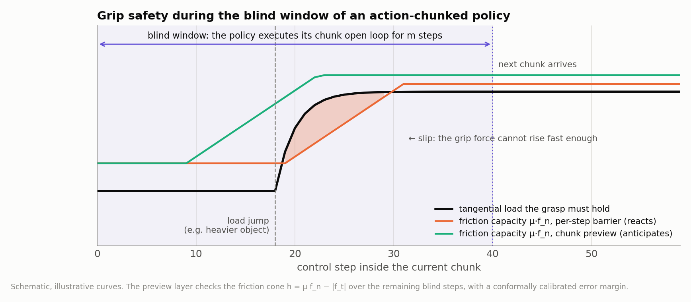
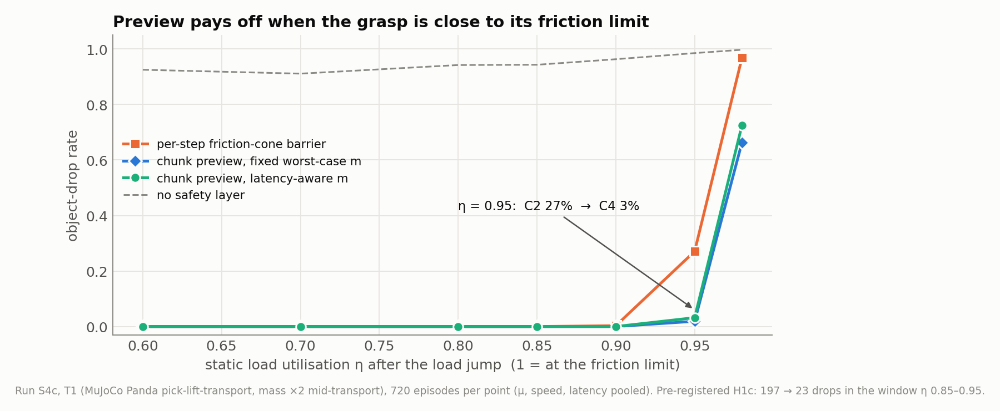

# Latency-aware slip safety for action-chunked robot policies

**Research in progress · first-author paper · simulation study · preprint planned for early 2027**

Vision-language-action models and diffusion/flow policies output *chunks* of actions. While the next
chunk is computed, the robot executes the rest of the current one open loop, for $m$ control steps
that grow with inference latency. My [real-time VLA study](../vla-realtime/) showed that $m$, not
latency in milliseconds, decides whether execution works.

In contact tasks the contact state can change inside those $m$ blind steps: the object turns out
heavier or more slippery, or gets bumped. Existing safety layers for such policies constrain geometry
(collision), normal force (crushing) or energy (passivity). None constrains **tangential** force, so
none prevents a grasp from slipping, and none adapts to how long the policy will be blind.

## Approach

A low-level safety layer between the chunked policy and the gripper / impedance controller:

1. **Per-step friction-cone barrier.** A discrete-time control barrier function on
   $h = \mu f_n - \lVert f_t \rVert$, solved each control cycle over grip force and a chunk time-scaling factor.
2. **Chunk preview with a latency-dependent margin $\delta(m)$.** The current chunk predicts the tangential
   load for the remaining blind steps. The layer checks that the grasp stays recoverable under the
   gripper's force and rate limits for all of them, and squeezes or slows down early, only when needed.
3. **Conformal error bounds and early re-query.** Prediction-error bounds are calibrated with conformal
   prediction. When the margin is about to run out before the next chunk arrives, the layer asks the
   policy for the next chunk early, which shrinks $m$.

## Status of the pre-registered claims

Every stage is pre-registered (hypotheses, decision rules and code hashes committed before the main
runs). Comparisons use paired anytime-valid confidence sequences, the method from my
[policy-evaluation project](../policy-evaluation/). More than 110,000 simulated episodes so far, in a
MuJoCo Panda pick–lift–transport task.

| Claim | Result so far |
| --- | --- |
| Latency-aware preview finishes faster than a fixed worst-case margin at the same drop rate | **Supported** in three independent matrices (S4, S4b, S4c); in S4c it is faster in 95.5% of pairs |
| Preview reduces drops versus a per-step barrier | **Original form failed** (S4: 32 → 24 drops, −25%, pre-registered target −50%; S4b with a rate-limited gripper: 0 vs 0). **Conditional form supported** (S4c): when the static load is near the friction limit, 197 → 23 drops in the window η 0.85–0.95 |
| Early re-query keeps safety with fewer policy calls | 39% fewer requests than a fixed trigger at equal safety; no gain in completion time |
| Conformal bounds transfer to new objects | Coverage 0.913 on the shifted set, below the pre-registered target; reported as a limitation |

One lesson so far: the benefit comes from *previewing the chunk* rather than from scaling with $m$. The
fixed-margin preview (C3) does as well as the latency-aware one (C4) on drops; it is only slower. The
paper is being narrowed to what the data support.

## Next

- S4d: a control run that changes only the calibration table, to test why the per-step barrier fails
  on a rate-limited gripper.
- S5: validation on LIBERO with SmolVLA and real inference latency, reusing the
  [real-time execution pipeline](../vla-realtime/).

Code and data will be released with the preprint.
