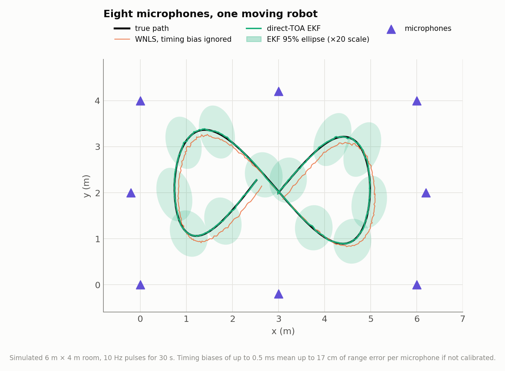
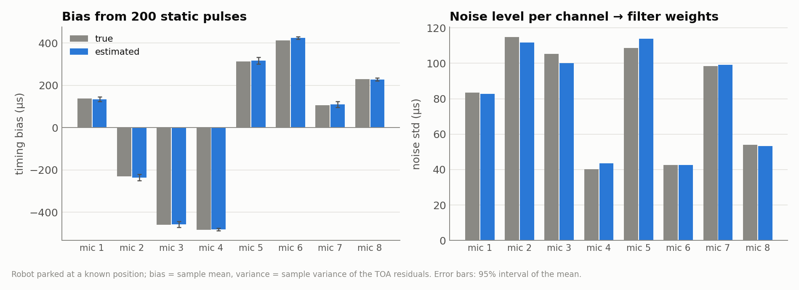
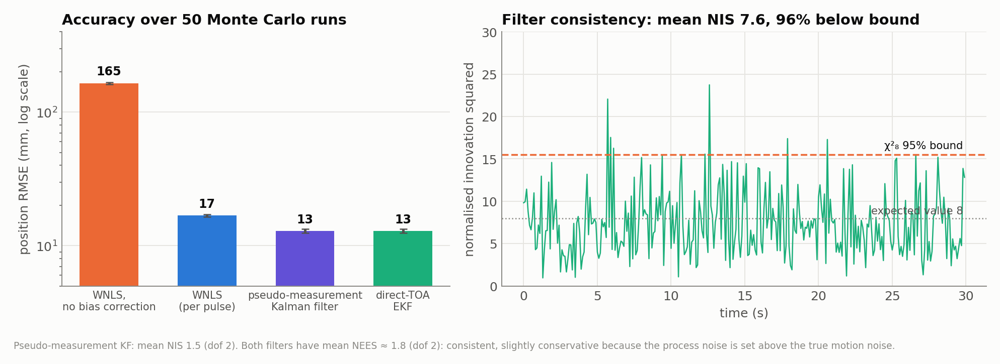
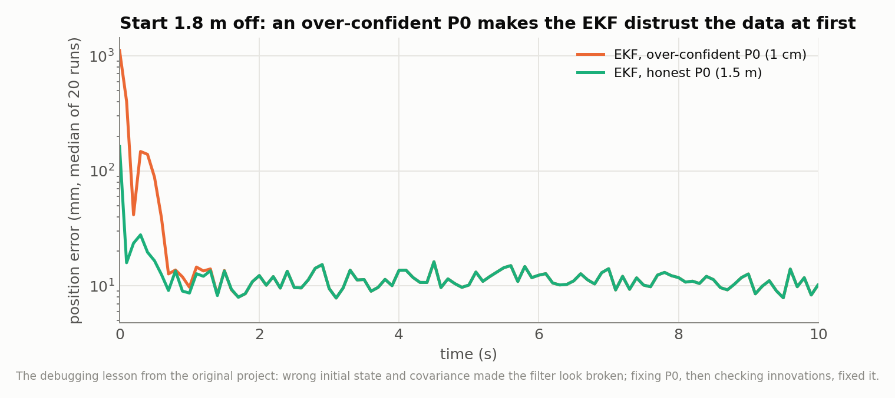

# Acoustic TOA calibration and EKF localization

**Sensor calibration · nonlinear least squares · Kalman / extended Kalman filtering · consistency checks**



A mobile robot emits a sound pulse ten times a second; eight microphones record when it arrives.
Every channel has an unknown timing offset (cable and converter latency) and its own noise level. The
goal is to estimate the robot's trajectory with honest uncertainty. The pipeline has three steps:
calibrate the sensors, linearise the measurement correctly, and check the filter's consistency instead
of trusting it.

> Clean-room re-implementation of a TU Delft *Filtering and Identification* course project that I did
> alone in MATLAB. The course data and the original code are not published. This version is new code in
> Python on simulated data, built to show the same methods end to end.

## Model

Time of arrival at microphone $i$ (known emission time, sound speed $c$):

$$
y_i = \frac{\lVert p - m_i\rVert}{c} + b_i + e_i, \qquad e_i \sim \mathcal N(0,\sigma_i^2),
\qquad \frac{\partial y_i}{\partial p} = \frac{(p - m_i)^\top}{c\,\lVert p - m_i\rVert}.
$$

Motion model: constant velocity with white-acceleration noise, state $x = [p_x, p_y, v_x, v_y]$.

## Pipeline and results

| Step | What it does | Result (50 Monte Carlo runs) |
| --- | --- | --- |
| **Calibration** | Robot parked at a known position for 200 pulses; bias = sample mean, variance = sample variance of the TOA residuals | Biases of up to ±0.5 ms recovered to within 12 µs (4 mm of range). Left uncalibrated they cost **165 mm** of RMSE |
| **Weighted NLS** | Gauss–Newton per pulse on the bias-corrected TOAs, weights $1/\sigma_i^2$, covariance $(H^\top W H)^{-1}$ | **17 mm** |
| **Pseudo-measurement KF** | Linear KF on the NLS fixes, each with its NLS covariance as measurement noise | **13 mm** |
| **Direct-TOA EKF** | The eight TOAs as the measurement, analytical Jacobian, Joseph-form update | **13 mm** |
| **Consistency** | Normalised innovation squared (NIS) against $\chi^2$, NEES against the truth | EKF mean NIS 7.6 (dof 8), 96% below the 95% bound; NEES ≈ 1.8 (dof 2) |





The two filters end up equally accurate. That is expected here: with a good NLS covariance, the
pseudo-measurement KF passes on almost the same information as the EKF. The EKF's advantage is
structural. It still works when fewer than three microphones hear a pulse, where no per-pulse fix
exists, and it has no extra linearisation step.

## What went wrong first

In the original project, poor choices of the initial state and covariance made the filters look broken.
The fix was to set $P_0$ to reflect the actual initial uncertainty, then check innovations and residuals
before reading anything into the trajectory. The simulation reproduces the effect. Starting 1.8 m off
with an over-confident $P_0$ (1 cm), the EKF's error over the first 2 s is about 7× larger (270 mm vs
38 mm) than with an honest $P_0$.



## Code

```
toa_ekf/
  core.py         measurement model + Jacobian, calibration, WNLS, constant-velocity KF, EKF, NEES, ellipses
  experiment.py   simulation, 50 Monte Carlo runs, initialisation study -> results/metrics.json
figures/          make_figures.py
tests/            Jacobian vs finite differences, calibration recovery, noise-free WNLS, filter consistency
```

```bash
pip install numpy matplotlib pytest
python -m toa_ekf.experiment
python figures/make_figures.py
python -m pytest tests -q
```

## Limits

- Simulated data with a known emission time (TOA, not TDOA), 2-D, no multipath and no outliers; real
  acoustic data would need gating of reflections.
- The process noise is set above the true motion noise, so both filters are slightly conservative
  (NEES 1.8 instead of 2).
