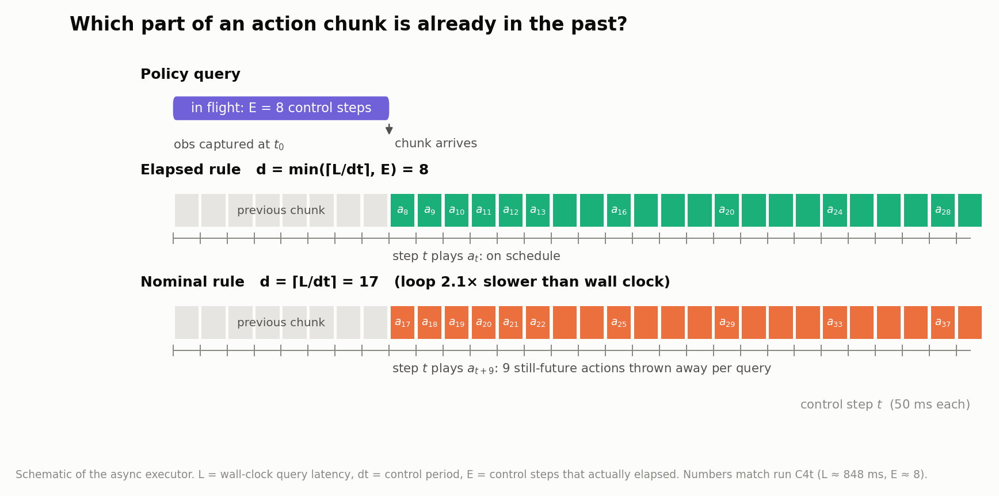
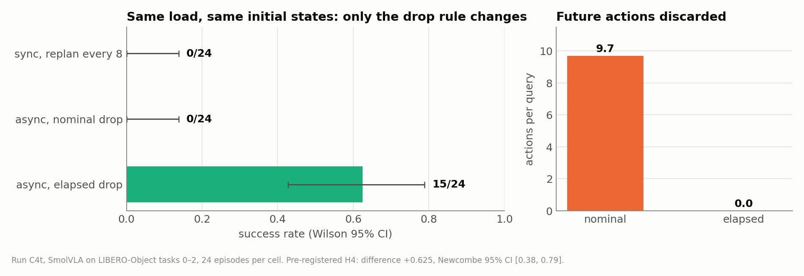
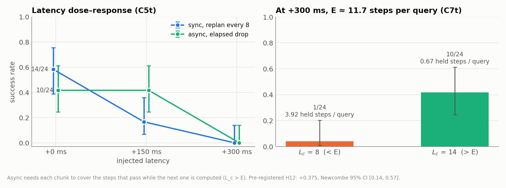
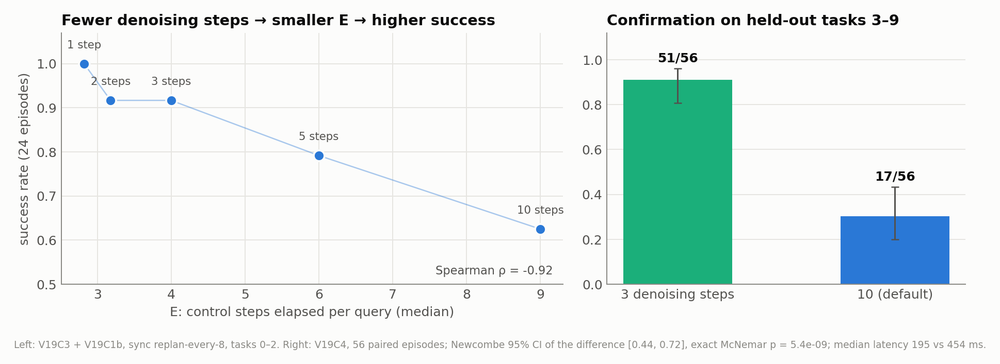
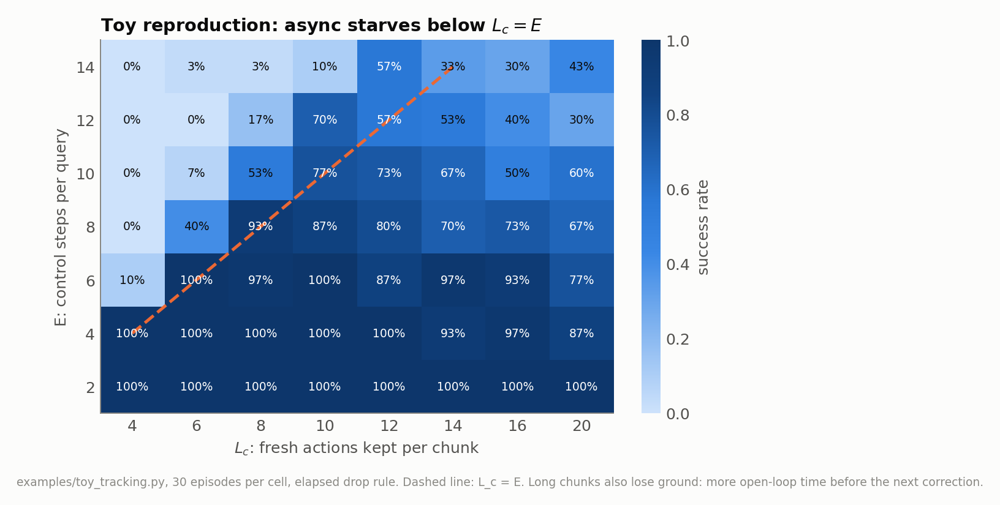

# Real-time execution of a VLA policy

**SmolVLA on LIBERO-Object · action chunking · latency · pre-registered experiments**



A vision-language-action policy is slow compared with the control loop it drives.
SmolVLA needs a median of **389 ms** per query on my GPU, i.e. about **8 control periods** of 50 ms.
Benchmarks hide this by pausing the simulator during inference. When the world keeps moving,
executing the policy synchronously misses **88%** of control deadlines and the success rate drops to zero.

I built the execution layer between a chunking policy and a real-time loop, found the bug that made
asynchronous execution fail, and measured what actually decides real-time success.

## Results

| Finding | Evidence |
| --- | --- |
| Dropping stale actions by **wall-clock latency** discarded ~9.7 still-valid future actions per query when the loop ran slower than real time. Dropping by **control steps actually elapsed** fixed it: success **0/24 → 15/24**. | Pre-registered H4, Newcombe 95% CI +0.38 to +0.79 (run C4t) |
| Real-time success is governed by $E$, the number of control steps that pass while a query is in flight - not by milliseconds. Async execution needs each chunk to supply $L_c > E$ fresh actions. At $E \approx 11.7$: $L_c=14$ gives **10/24**, $L_c=8$ gives **1/24**. | Pre-registered H12, CI +0.14 to +0.57 (C7t) |
| Fewer flow-matching denoising steps shrink $E$ and win in real time. On held-out tasks 3–9: **3 steps 51/56 vs 10 steps 17/56**. | Newcombe CI 0.44–0.72, exact McNemar $p = 5.4\times10^{-9}$ (V19C4) |
| Not every hypothesis held: at +300 ms async did **not** beat sync (H7 failed, both 0/24). | C5t |



## The mechanism

A chunk planned from the observation at step $t_0$ contains actions $a_0, a_1, \dots$ meant for steps
$t_0, t_0+1, \dots$. When it arrives $E$ steps later, the executor must drop the expired prefix
$a_0 \dots a_{d-1}$ and append the rest to the action queue.

$$
d_{\text{nominal}} = \left\lceil \frac{L}{\Delta t} \right\rceil
\qquad\qquad
d_{\text{elapsed}} = \min\!\left(\left\lceil \frac{L}{\Delta t} \right\rceil,\ E\right)
$$

The two agree only if the loop runs exactly at real time. In run C4t another job shared the CPU:
wall latency rose to ~848 ms ($d_\text{nominal} \approx 17.8$) but the simulator slowed down too, so only
$E \approx 8.1$ steps actually passed. The nominal rule skipped ~9.7 actions per query and the arm played
commands meant for the future. Any robot whose control loop can stall (logging, rendering, a busy
onboard computer) has the same failure mode.

Once the prefix is right, the queue must not run dry: the next chunk takes $E$ steps to arrive, so the
current one has to cover them.



That is also why fewer denoising steps help: they cut latency, hence $E$.



## Try it without a GPU

`examples/toy_tracking.py` drives the same executors with a toy chunking planner that tracks a moving
target under a slow query. It reproduces the mechanism (not the numbers) in a few seconds:

```text
$ python examples/toy_tracking.py
Experiment 1 - loop 2.1x slower than real time, E ~ 8 steps
  async_nominal      success   3/60  (dropped - elapsed)/query +9.0
  async_elapsed      success  20/60  (dropped - elapsed)/query +0.0
  sync_replan8       success   0/60
  paused_reference   success  60/60
```



## Code

```
realtime_chunking/
  executor.py     SyncChunkExecutor, AsyncChunkExecutor, drop rules, simulated + threaded requesters
  stats.py        Wilson / Newcombe intervals, exact McNemar
examples/
  toy_tracking.py numpy-only reproduction of the mechanism
  libero_eval.py  SmolVLA + LIBERO integration (runs in the container)
docker/Dockerfile CUDA 12.8 image: LeRobot v0.4.4, LIBERO 8f1084e, SmolVLA pinned to a Hub revision
results/          numbers behind every figure, each tagged with its run id
figures/          make_figures.py regenerates all plots from results/
tests/            executor behaviour + statistics checked against the reported values
```

```bash
pip install numpy matplotlib pytest
pytest tests                       # 6 tests
python examples/toy_tracking.py
python figures/make_figures.py
```

All three executors share one interface - `action = executor.step(obs, t)` once per control step - so
the same code runs the toy, the LIBERO study, or a real robot loop.

## How the experiments were run

- Two timing protocols: *paused* (inference stops the simulator, as in standard benchmarks) and
  *continuous* (the simulator keeps stepping; the arm holds its last target while waiting).
- Each comparison was written down with its decision rule and hashed before the first episode; the
  evaluator refused to start if the pre-registration had changed.
- Same tasks and initial states across compared cells; success rates reported with Wilson intervals and
  differences with Newcombe intervals.

## Limits

- Simulation only, no robot. Main grid: 3 LIBERO-Object tasks × 8 initial states (24 episodes per cell);
  these tasks are quasi-static.
- Extra latency was injected with `sleep`; the async worker thread competes with the simulator for CPU.
- The paused and continuous protocols execute chunks differently, so comparisons across protocols differ
  in more than $E$.
- The experiments were run with my original research scripts. `realtime_chunking` and
  `examples/libero_eval.py` are a cleaned-up rewrite of the same logic; the executors are unit-tested,
  but the LIBERO grid has not been re-run end to end with the rewrite.

The policy (SmolVLA) and the benchmark (LIBERO) are existing work by their authors; this project is
about executing them in real time.
